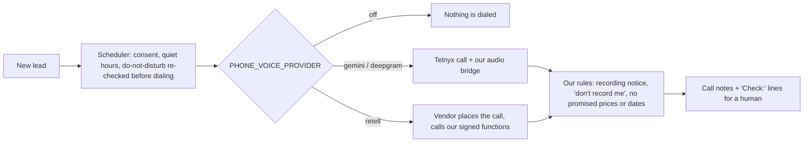

# Picking a voice AI by testing it, then building so I could change my mind

*How I chose voice providers for a CRM's phone intake and in-app assistant, and why switching vendors became a config change. October 2026.*

## The problem

I'm building a CRM for service businesses: contractors, pool companies, law firms. Two features need a voice:

1. **An in-app assistant.** The owner talks to the app ("who's waiting on me today?") and it answers out loud.
2. **A phone intake caller.** When a new lead comes in after hours, an AI calls them back, asks the intake questions and books the follow-up.

The two have different bars. In the app, a person is staring at a screen, so **speed** matters most. On the phone, the AI is talking to a stranger on the business's behalf, so **following the rules** matters most. It has to say the call is recorded, honor "don't record me," and never promise a price or a date it can't keep. A broken rule there is a legal problem and a trust problem, not a bad demo.

Then my original provider, **Hume**, announced it was shutting down its voice API ([changelog](https://dev.hume.ai/voice/changelog.md), October 2, 2026: access ends November 13, 2026). I had a few weeks to replace it.

## The bake-off

Instead of reading vendor pages, I built a harness that ran the same test against every contender:

- **The same scripted callers.** Invented leads, including a Spanish speaker and one who says "don't record me."
- **The same system prompt and tool definitions** for each channel, and the same mocked tool results.
- **The same scoring:** time from the caller's last word to the agent's first audio, whether every tool call had the right name and arguments, rule breaks, and a judge score on the transcript.
- **No real phone calls.** Each provider was reached over its streaming API, so nobody was dialed while I was testing.

Four contenders, each behind the same small adapter:

| Contender | Shape |
|---|---|
| xAI Grok Voice Agent | speech-to-speech, realtime socket |
| Google Gemini Live | speech-to-speech, realtime socket |
| Telnyx AI Assistant (running Claude Haiku) | telephony vendor's hosted agent |
| A pipeline I built: Google speech-to-text → Claude Haiku → Google text-to-speech | separate pieces, sentence-by-sentence |

A missing API key produced a "no key" row, not a crash, so the report always ran.

## What the results said

The data split the decision by channel:

| | Grok | Gemini Live |
|---|---|---|
| In the app: time to first audio | **0.86 s** | 1.7 s |
| Phone: rule breaks | 2 (promised a date; ignored "don't record me") | **0** |
| Phone: judge score | lower | **97–100** |
| Spanish caller kept in Spanish | yes | **every time** |
| Relative price per minute | about 5× | **1×** |

So I didn't pick one winner. **Grok went into the app**, where speed is what a person feels. **Gemini went on the phone**, where it broke no rules and cost about a fifth as much.

## The architecture that made it cheap to change

Every provider sits behind one interface, with a single setting choosing which one is live: `deepgram`, `retell`, `gemini` or `off`. Both environments ship as `off`, which works as the kill switch. The parts I care about most don't live in any vendor:

- **The rules are ours, not the model's.** The recording notice is a fixed opening line, not an instruction the model might skip. If a caller says "don't record me," our own check on their words stops the transcript, even if the model never calls the tool. If the agent promises a price or a date, our check flags it in the notes for a person to fix, because spoken words can't be taken back.
- **Failure is polite.** If the voice provider drops, times out or refuses, the phone system says a short apology, the call is marked for a callback, and the team gets a notification.
- **Guardrails are counted, not hoped for.** There's a call-length limit, caps on concurrent calls, a check that refuses forged audio streams, voicemail detection, and a rule that a call more than 30 minutes late is closed instead of ringing someone out of the blue.

## Then real calls changed the answer, twice

The bake-off picked Gemini for the phone. Real test calls on my own phone told me more:

1. **Gemini on a live call** was slow to answer, gave no "mm-hm" acknowledgments, and rushed the caller off the line. One model was doing listening, turn-taking, speaking and following the rules at once, and its only tuning was voice-activity settings. **I moved the phone to Retell**, which handles the conversation mechanics, while my code kept the rules, tools and records.
2. **Retell** fixed the turn-taking but started speaking the instant I picked up, sped up on off-script questions, and cost the most per minute. I tuned the pace, then **added Deepgram's Voice Agent**: one socket that listens with a model built for voice agents, with end-of-turn detection inside the model and the trade's own words weighted, at a lower per-minute price than Retell.

Each move was a new adapter and a changed setting. The rules, the safety checks, the call records and the scheduler didn't change.

## What I'd tell someone choosing a voice vendor

- **Test with your own script, your hardest caller and your own rules.** The leaderboard that matters is the one built from your use case.
- **Split by channel if the data says to.** "Fast" and "safe" were different winners for me.
- **Keep the rules outside the model.** If compliance depends on the model obeying a prompt, you don't have compliance.
- **Make switching cheap before you need to.** I lost Hume to a shutdown and changed phone providers twice in a week, and none of it touched the business logic.
- **Bench results aren't the final word.** The bake-off got me to a good first choice. Real calls told me what it missed.

---

*Status, stated plainly: the in-app assistant runs on Grok. Phone intake runs in staging with test calls only; production stays off until the call-history screen ships.*
